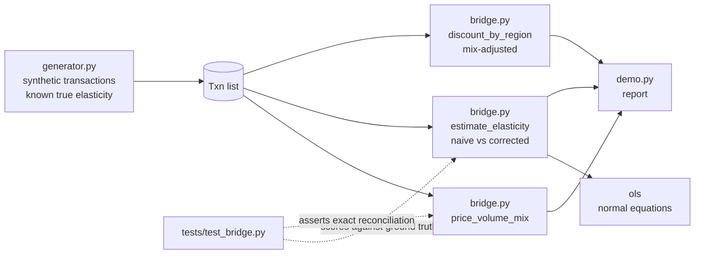

# marginbridge

A price-volume-mix margin bridge, plus price elasticity estimated against the confounder, so the pricing recommendation does not come out backwards.

[](https://github.com/SlateGitOrg/marginbridge/actions/workflows/ci.yml)

## Why

In an industrial distributor, sales reps have discount authority, and "margin is down" is usually one number hiding several unrelated problems: genuine price erosion, a shift toward lower-margin product lines, and one region that discounts far harder than the rest. Each needs a different response. On top of that, discounts in observational sales data are not random: reps give them to accounts that are already shrinking. A naive regression of volume on price therefore picks up that confounder instead of the causal effect, and recommends price cuts to chase volume that was never price-driven.

marginbridge separates the three margin effects with a bridge that reconciles exactly, and estimates elasticity both naively and with the confounder controlled, on synthetic data where the true elasticity is known, so the estimator is scored rather than eyeballed.

## Features

- Price / volume / mix bridge between two years, with explicit definitions for each component.
- Exact reconciliation: components must sum to the total margin delta, and any residue is reported as its own `unexplained` component instead of being absorbed.
- Segment-level elasticity, naive and corrected, each with a 95% confidence interval.
- Discount by region, raw and re-weighted to the company-wide segment mix, to find policy outliers that are not just customer-mix artefacts.
- Synthetic transaction generator with a chosen true elasticity per segment and a deliberately confounded discount mechanism.
- Standard library only: a small OLS (normal equations, Gaussian elimination) is included, so there is nothing to install.

## Architecture



`generator.py` produces two years of transactions across four product lines, three customer segments and four regions. `bridge.py` consumes them to build the bridge, fit the two elasticity models and compute the regional discount table. `demo.py` prints all three. More detail is in [docs/ARCHITECTURE.md](docs/ARCHITECTURE.md).

## Quick start

Requires Python 3.11+. No dependencies.

```bash
git clone https://github.com/SlateGitOrg/marginbridge.git
cd marginbridge
python -m unittest discover -s tests -v   # run the test suite
python -m src.demo                        # print the bridge, elasticity and regional report
```

## Example

Output of `python -m src.demo` (trimmed, seed `20260911`):

```text
  6,231 transaction lines across two years.
  Gross margin rate: 21.4% -> 20.8%  (-0.7 points)

  THE BRIDGE
    2025 margin           3,702,324
      volume                341,470
      mix                  -275,020
      price                 -37,935
    2026 margin           3,730,840
    reconciles:      True

  segment                true    naive        naive 95% CI  corrected    corrected 95% CI
  national_account      -1.80    -0.02       [-0.05, 0.01]      -1.96      [-2.55, -1.36]
  regional              -1.10    -0.01       [-0.04, 0.01]      -0.64      [-1.17, -0.11]
  trade_counter         -0.40    -0.01       [-0.04, 0.02]       0.02       [-0.61, 0.65]

  region          raw   mix-adjusted    lines
  west          13.6%          13.7%    1,491
  north          8.0%           8.0%    1,542
```

Total margin grew while the margin rate fell: volume growth is masking a mix-shift headwind (88% of it) and a smaller price-erosion headwind (12%). The naive elasticity is near zero in every segment and its interval excludes the true value each time. The corrected intervals cover the truth in every segment and are honestly wide for the nearly inelastic `trade_counter` segment. The `west` region discounts hardest even after adjusting for customer mix.

## How it works

**Bridge.** Per product line and year, units, revenue and cost are aggregated. Then:

- *volume*: change in total units, holding base-year mix and base-year per-unit margin.
- *mix*: change in each line's share of units, at base-year per-unit margin, applied to final-year units.
- *price*: change in per-unit margin, applied to final-year units and mix.

The three sum to the margin delta; a tolerance of 1e-6 decides `reconciles`.

**Elasticity.** The naive model is `log(units) ~ log(net_price)`. The corrected model regresses `log(units)` on `log(net_price / list_price)`, the account's prior demand trend (the observable proxy for the confounder) and product-line dummies, because base volumes differ by orders of magnitude across lines and omitting them would load that variation onto price.

**Regional discounts.** Each region's mean discount is recomputed as a weighted average of its per-segment means, using the company-wide segment mix as weights.

**Trade-offs.** Controlling for prior trend only works because the generator exposes it; with real data it must come from prior-period volumes. OLS standard errors assume homoscedastic residuals.

## Testing

```bash
python -m unittest discover -s tests -v
```

17 tests cover: exact bridge reconciliation, surfacing of residuals, a zero bridge over identical years, the corrected interval covering the true elasticity per segment, the naive interval excluding it, OLS recovering known relationships and rejecting singular designs, and detection of the planted heavy-discount region. CI runs the same command on Python 3.12.

## Project layout

```
src/
  generator.py   synthetic transactions with known elasticity and confounded discounts
  bridge.py      OLS, elasticity estimation, price-volume-mix bridge, regional discounts
  demo.py        end-to-end report
tests/
  test_bridge.py
docs/
  ARCHITECTURE.md
```

## Limitations

- All data is synthetic; the estimates are validated against the generator's ground truth, not real sales.
- This is a diagnostic tool, not a price-optimisation engine, and not a full causal-inference framework: it uses the minimum rigour needed to avoid a backwards answer.
- Bridge definitions are one reasonable convention; other organisations define price, volume and mix differently.

## License

MIT — see [LICENSE](LICENSE).
