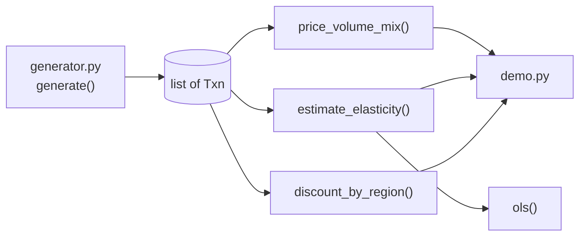

# Architecture

## Context

Sales representatives with discount authority see margin fall and the usual explanation is market pressure. In reality it is a mixture of price erosion, mix shift and one outlier region, and the pricing decision downstream depends on an elasticity that is easily estimated wrongly. marginbridge decomposes the margin movement and estimates elasticity in a way that can be checked against known truth.

## Container view

Everything is plain Python with no third-party packages. `Txn` is an immutable dataclass; revenue, cost and margin are derived properties.

## Key decisions

- **Bridge must reconcile.** Components are computed independently and compared against the actual margin delta; any difference above 1e-9 becomes an `unexplained` component rather than being folded into price, volume or mix. Trade-off: a visible residual is less tidy than a forced sum, but it cannot hide an error.
- **Confounder control.** Discounts depend on each account's prior demand trend, so the corrected model includes it as a regressor, along with product-line dummies and the discount ratio `net_price / list_price`. The naive model is kept alongside it so the contrast is visible.
- **Known ground truth.** The generator fixes a true elasticity per segment (-1.8, -1.1, -0.4), so tests assert interval coverage rather than only that code runs.
- **Mix-adjusted regional discounts.** Re-weighting to the company-wide segment mix stops a region from looking generous merely because it serves price-sensitive customers.

## Failure modes

- A singular design matrix raises `ValueError` instead of returning coefficients.
- A bridge that does not reconcile is exposed through `Bridge.reconciles` and the `unexplained` component.
- Segments with little price sensitivity produce wide intervals, which are reported rather than hidden.

## Out of scope

Price optimisation, real data ingestion, heteroscedasticity-robust errors, and instrumental-variable estimation.
